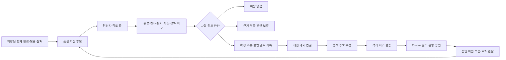

# 평가 품질 관리 — 재사용 계약·검토 프로세스

[Phase 1](admin-analytics-phase1-20261104.md). **설계 준비 / 품질 데이터 PARTIAL / 운영 구현 승인 대기**. 기존 HQP·QL/QLM·Registry·Evidence·History·TASK16-L을 재사용한다. 일반 admin 권한을 학생 원문 열람 권한으로 자동 승격하지 않는다.

## 현재 조회 가능성

상태는 ‘저장소에 있음’과 ‘관리자 통합 화면에서 됨’을 분리한다. AVAILABLE은 모든 서비스/과거 기록이 완전하다는 뜻이 아니다.

| 항목 | 상태 | 실제 저장·조회 / 부족한 연결 |
|---|---|---|
| 평가 ID | AVAILABLE | legacy evaluation, exam run+question, math evaluation ID 존재. source namespace로 구분; child를 parent와 이중집계 금지 |
| 사용자 ID | AVAILABLE / UI PARTIAL | runs.account_id→credit_accounts.user_id, Math attempt.student_id. ql 가명, qlm UI 일부 ‘사용자 확인되지 않음’. 분석은 가명/집계, 본문엔 최소 식별 |
| 대학·시험·문항 | PARTIAL | Registry/essay_exams/questions, snapshot questionId, Math leaf/profile. qlm 화면 ‘문제 정보 미연결’ 실확인. 순서index를 공식문항번호로 추정 금지 |
| 최초·재첨삭 관계 | AVAILABLE / 통합 PARTIAL | exam.parent_id/previous_paid_run_id/submission_index, Math predecessor/prior_evaluation/lineage, legacy session/attempt. 기술retry와 학생재작성 분리 |
| 학생 원본 답안 | PARTIAL | legacy body, run.snapshot.answers, Math typed/Evidence 참조. 운영 Math 확정전사 존재해도 typed null 가능. 사진object권한·보존/삭제상태를 따라 필요할 때만 조회 |
| OCR 원문 | PARTIAL | Math extraction_runs/regions 존재(24/239), 선택extraction과 raw/전사 버전 참조. 모든 인문/혼합 사진의 raw OCR 보존을 전수 확인하지 않음 |
| 학생 확정 전사 | PARTIAL | Math selected_extraction/confirmed-input 경로와 TASK16 사례 확인. 원본OCR와 확정전사의 비교 가능한 field projection/동일사진hash 검증 필요 |
| 평가 요소 | AVAILABLE / 통합 PARTIAL | legacy dimensions/criteria, Math profile/criteria, exam 결과 및 evidence/rubric version. 당시고정기준과 현재catalog 기준을 구분 |
| 평가 결과 | AVAILABLE / 통합 PARTIAL | legacy0/exam56/Math13 운영 확인. QL일반은 legacy만, QLM은 Math COMPLETED. 실패·보류 검수대상 포함 계약 보완 |
| 개선 과제 | PARTIAL | 학생용 improvement_progress/items·결과 actions 존재. ‘학생 보완과제’와 ‘운영 품질개선 issue’ 다름. 후자의 issue/회귀 연결 원장 미연결 |
| 단계별 힌트 | PARTIAL | Math 결과 hints/기존 disclosures/exposures, mixed coaching hint 저장. 힌트테이블0은 모든 결과본문에힌트없음을 뜻하지 않음. 전체노출·사용품질 분모 미확정 |
| 학습용5단계 | PARTIAL(TEST), 운영 NOT_CONNECTED | TASK16-L 단독math nullable learning_judgement / 혼합 child evaluation.learning_judgement. 운영 단독컬럼없음. 기존 criterion1~5와 절대혼용 금지 |
| 평가 정책 버전 | PARTIAL | contract/model/prompt/regime/Math profile 및 snapshot 버전. TASK16-L policy/rubric이후 신규분 저장, 과거필드누락을 현재버전으로 채우지 않음 |
| Evidence Package 버전 | PARTIAL | legacy manifest/input/output hash/frozen bindings, exam rubricVersion/evidenceVersion, Math profile/source/authority refs. 전체버전재현가능성은 source별검증 필요 |
| Provider 호출 | PARTIAL | legacy processing runs, exam receipt checkpoint, Math result telemetry. 비용view185행 전부시각/비용미상, Math전용호출집계누락. receipt없는실패도UNKNOWN |
| 보류·실패 이유 | PARTIAL | state/error_code/checkpoint failure와 Math semantic outcome 저장. COMPLETED 안의 판단보류를 별도투영해야 함. 구조완료를정확도PASS로 세지 않음 |
| History | AVAILABLE / 통합 PARTIAL | legacy/Math lineage, 본인essay_exam_history 최근50. 관리자전학생exam read 연결없음. 열람행동(History 이용률)은별도GA 수신미검증 |

**MISSING/미연결 영역**: 전학생 회차/혼합형 품질 검수 subject adapter, 오류후보→개선issue→정책수정→회귀증거→배포효과 연결. 관련 read모델/최소검토 확장은 Phase2 검토이며 새 평가/History/5단계 원장을 만드는 선택이 아니다. OCR 정정행위별 정확한 이벤트분모·History행동 수집은 NOT_VERIFIED로 두며 신규수집 필요성부터 검토한다.

## 기존 HQP 계약과 통합안

`human_quality_judgments`/`human_quality_findings`가 운영에 설치되어 있고 현재0행. legacy evaluation_id와 math_evaluation_id 참조가 존재한다. `ql_submit_human_judgment`는 expected_output_sha256, client_submission_id, rubric_version, official_source_reviewed, target_ref와 supersedes를 검증하고 불변 판단을 추가한다. 멱등키 재사용시 동일payload만 replay, 다른payload 충돌. QL/QLM은 별도quality ACL과 account lifecycle을 사용한다.

회차형은 기존evaluation_id FK에 run ID를 끼워 넣거나 가짜legacy 평가를 만들 수 없다. Phase2는 **기존HQP의 호환 가능한 subject 확장**을 우선 비교한다: source=legacy/math/exam_question, 원본 ID+question ID+output hash. 기존FK/불변이력/클라이언트멱등성/정정연결을 보존하는 SQL 후보와 rollback을 별도 검수한다. 새 필드/테이블 확정이나 운영 적용 승인이 아니다. 같은 run의 전체평가와 문항판정을 각각 정의하고 child결과를복제하지 않는다.

조회용 adapter는 기존 read RPC를 확장/조합한다. admin 운영요약에는 원문을 반환하지 않고, quality 권한 상세만 원본/전사/근거를 읽는다. `/owner-review/essay/`의 본인권한을 확대하거나 서비스키를 브라우저에 넣어 우회하지 않는다. Math 현재목록은 loaded범위의 details를 미리 조회하므로 Phase2에서는 선택행단위로 읽어 개인정보/호출량을 최소화한다.

TASK10의 ‘검수6항목 수치평가’와 TASK16-L의 ‘학생 학습5단계’, 사용자 ‘만족도1~5’는 **서로 다른 계약**이다. 기존 HQP 판정형 rubric을 숫자로 환산하지 않는다. 새 검수 rubric이 필요하면 별도version/앵커/NA/검토자간일치도를 설계한다.

## 품질 화면 기능

| 화면 | 기능과 근거 |
|---|---|
| 현황 | 처리완료·판단보류·사람검토 coverage·확정오류비율·미검토후보·정책version 분리. 건수/분모/미확인 포함 |
| 후보 목록 | source·대학/시험/공식문항·요청/완료·판단보류·후보이유·severity·policy·review상태 필터. 자동표시 항상 ‘의심/검토후보’ |
| 평가 상세 | 원본사진/입력, OCR/학생확정 비교, 당시공식기준, 실제결과/근거/힌트, 최초↔재첨삭, Provider/provenance, 기존사람검토 |
| 판단 입력 | 오류category·근거target·심각도·검토불가사유·추천조치. ‘이상없음’도 근거와기록. 기존학생결과수정버튼 없음 |
| 개선 연결 | 저장된judgment/finding ID에서 기존개발issue 또는 회귀근거 문서로 연결. 답안본문을GitHub issue에복사하지 않음 |
| 정책 비교 | 동일 고정case/policy/model/prompt/evidence, 이전판정/신판정 및 검토자결과. 서로다른학생집단의 전후차를정책효과로단정 금지 |
| 회귀·효과 | TEST 실행환경/commit/fixturehash/결과·사용량/승인·운영배포버전 연결. 운영관찰은source별coverage/기간/표본 명시 |

## 검토 상태 전이와 오류 분류

이는 검토업무상태이고 학생evaluation.state를 덮어쓰는 상태기계가 아니다. 후보 해소/재개도 이력을 남기며, 학생결과 재평가나 환불을 자동실행하지 않는다. 잘못된 사람판정은 supersedes로 정정하고 원판정/검토시각/당시결과hash를 보존한다. 개선과제 해결과 실제운영배포를별도상태로둔다.

| 분류 | 검토 기준 |
|---|---|
| OCR 오류 | 사진↔raw OCR↔확정 전사 구분. 사진미확인일 때OCR오류확정 금지 |
| 계산 오류 | 학생식과공식기준으로 독립검산. 모델의맞다/틀리다문구만근거로삼지않음 |
| 정답 오판 / 오답 오판 | 올바른풀이를오답으로/틀린풀이를정답으로 인정한 방향 구분, 대안풀이 인정 |
| 평가 보류 | 답안/근거부족의타당보류와 존재답안무시 등부당보류 구분 |
| 평가 근거 불일치 | frozen Evidence·문항·기준·학생관측ID의실제연결 확인 |
| 힌트 품질 | 단계적도움·실행가능성·정답유출·불필요과제 여부; 공개승인경계 유지 |
| 5단계 불일치 | TASK16-L policy/rubric/독립검토hash 확인, 공식점수 환산금지 |
| UI 표시 오류 | 저장값정상/투영·표시누락 분리. UI수정으로과거판정을수정하지않음 |

## TASK16 실사례를 회귀 기준으로 사용

1. **인하 최초 보류**: 확정전사가 있는데 typed_answer null을 답안없음으로 해석, steps0/NOT_ATTEMPTED/NOT_DETERMINABLE로 COMPLETED. ‘완료=품질PASS’ 반례. 과거 원본불변, TEST 동일전사새ID 평가로 정상7단계 확인. 원본사진 OCR자체의정확도 재검증은아님.
2. **8/9→9/8 합성 오류 대조군**: candidate4가잘못된최종값을정답으로받음. 독립검산거절, candidate5는부분정답/국소계산오류·힌트로분류. 합성전사변형이지실사용자OCR사건아님. 원본학생평가수정금지.
3. **중앙 공식문제2와 내부q1 혼동**: q0=공식문제2, q1=공식문제1, q2=Math문제3. UI/운영 집계에서 official label·ID·snapshotordinal을함께보존한다.
4. **인하 공식해설 후속연결**: 평가당시근거와 나중에추가된공식자료를구분. 현재자료를과거판단에소급적용하지 않는다.
5. **TASK16-L 실제 비교 결측**: TEST재첨삭level4 저장/조회는PASS, 최초level없어 NO_PREVIOUS_ASSESSMENT. 합성2→4+2 local검사를실학생성장으로표시금지. 단독Math 신규저장E2E는PARTIAL.

## TASK16-L 재사용 경계·완료 조건

후속소스의 nullable learning_judgement, 검토candidatehash, policy/rubric/model/prompt/evidence, assessed_at, 기존 Math/혼합coaching·History 계약을 그대로소비한다. 동일문항/소유lineage/호환정책·기준의 실제값만비교한다. 결측은미평가, 불확실은판단보류, 버전불일치는비교불가. 평균요소점수/오류수→학습단계 계산이나 과거backfill 금지.

Phase2 수용기준: source별읽기coverage, Q없는운영자/일반학생/익명거절, 다른계정전환시본문제거,원본hash보존, frozen자료누락표시,멱등검토/동시정정충돌,실제품질후보양성·음성표본, TEST회귀와실Provider품질의구분, 학생Credit무변화. 운영회귀Provider실행은 이설계승인에포함되지않는다.
