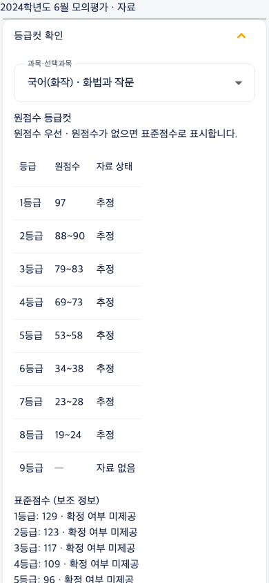
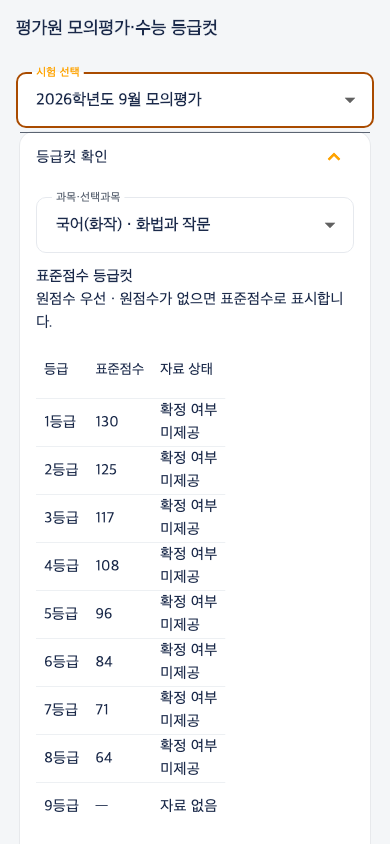
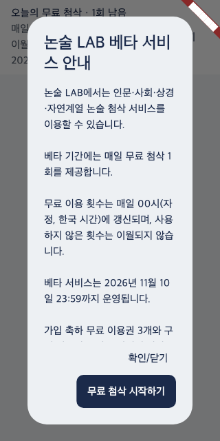

# TASK19 — LAB 안내와 평가원 등급컷

## Owner 범위와 보존
2026-11-05 Owner는 iOS 1.0.1 심사 통과를 알리고 후속 업데이트 A/B를 승인했다. APP58 산출물·버전, 운영 평가/이용권/History, 다른 PDF 개발 브랜치를 보존한다. Store 제출·운영 DB 적용은 승인 범위 밖이다.
[기존 베타](essay-beta-daily-v2.md), [공통 공개 계약](app58-expanded-production-connection-20261104.md), [등급 판정](day-8-d3-grade-result.md), [장기 데이터 전략](longitudinal-learning-admissions-data-strategy.md)을 재사용한다.

## A — 구현 및 검증
- 베타 안내를 인문·사회·상경·자연으로 수정. CTA 무료 첨삭 시작하기. 매일 00시 KST/이월 없음/가입3·구매 유지. 실제 종료 11/11 00KST와 표시 11/10 23:59 유지. 체크박스·scrollable modal·무료 재첨삭 서버 정책 변경 없음.
- 상세 준비 중 표시는 통합 공개 목록 외에도 기존 standalone Math의 정확한 exam/question/leaf 연결과 Provider 활성 상태를 확인한다. 자연계 이름만으로 공개하지 않는다. 미연결 질문·중복/잘못된 leaf는 준비 중을 유지한다. 서버 제출/정산 권한은 변경하지 않는다.
- 운영 읽기 확인: 건국2026자연 exam `25dc068b-4672-56e1-b8df-08ee8800e2f6`, Q1 `cea40cf3-dc05-507a-a6eb-fd5e1e1847bb`, leaf `3bab07d3-c047-53c2-89ad-9fa20ec7b3f3` release_catalog 연결. 전체4문항 공개를 주장하지 않는다.
- Flutter beta/gateway/상태 단위·위젯19 PASS, catalog/session/credit/history/round 회귀24 PASS, analyze 오류0.
- 새 실기기·실제 Provider 검증 NOT_VERIFIED. 기존 평가 재호출/차감0. 수정 화면 런타임 검수는 별도로 필요하다.

## B — 데이터 조사·구현
운영 읽기에서 대상11시험 모두 기존 exams/content_items와 연결됨. 기존 `grade_cutoff_versions`는 0행이며 raw_absolute/raw_estimate 전용이다. 표준점수를 minimum_scores에 넣지 않고 기존 Registry 복합키를 참조하는 부가 조회 `grade_cutoff_references` + `grade_cutoff_lookup(uuid)` 후보를 구현했다. 운영/격리 Supabase 적용은 모두 0회. 실제 운영 schema와 migration 존재를 혼동하지 않는다.

### 시험별 확보 현황
전체 273과목·선택과목 조합 × 9등급 = 2,457행. 실제 점수 확인 2,212행(90.03%), 미확인 경계 NULL 245행. 확인된 점수 중 원점수 2,092행(94.58%), 표준점수 대체 120행(5.42%). 전체 대상 행 기준 원점수 확보는 85.14%다. 원점수 범위를 단일 숫자로 변환하지 않는다.

|학년도|시험|기존 게시글|원점수 행|표준점수 대체|미확인 NULL|
|---|---|---|---:|---:|---:|
|2024|6월|[1516](https://legendstudy.com/1516)|194|0|22|
|2024|9월|[1525](https://legendstudy.com/1525)|194|0|22|
|2024|수능|[1574](https://legendstudy.com/1574)|194|0|22|
|2025|6월|[1618](https://legendstudy.com/1618)|193|0|23|
|2025|9월|[1634](https://legendstudy.com/1634)|193|0|23|
|2025|수능|[1649](https://legendstudy.com/1649)|193|0|23|
|2026|6월|[1665](https://legendstudy.com/1665)|194|0|22|
|2026|9월|[1686](https://legendstudy.com/1686)|154|40|22|
|2026|수능|[1700](https://legendstudy.com/1700)|154|40|22|
|2027|6월|[1706](https://legendstudy.com/1706)|154|40|22|
|2027|9월|[1710](https://legendstudy.com/1710)|275|0|22|

- 각 시험: 국어2선택·수학3선택·영어·한국사·사회9·과학8, 총24조합. 2027년9월만 실제 Registry에 등록된 제2외국어/한문9과목 추가. 다른 시험의 제2외국어는 Registry/원문 연결을 임의 생성하지 않았다.
- 기존 게시글11개 이미지224개를 우선 확인. 국어·수학22개 표를 직접 대조, 탐구/영어/한국사191개는 두 로컬 Vision 결과를 교차 비교하고 불일치389셀을 원본 대조했다. 표 제목과 기존 과목ID를 대응했다. 중복·점수범위·등급순서·출처해시·학년도/월 검증 통과. 원본 이미지는 Git에 넣지 않았다.
- 국어·수학 원점수는 추정으로 표시. 게시글의 표준점수·탐구는 원출처 확정 상태가 명시되지 않았으므로 `unspecified`로 보존. 공식 확정으로 격상하지 않는다. 향후 KICE 채점 결과와 교차 검수하면 새 revision을 만든다.
- 2026학년도9월/수능, 2027학년도6월 국어·수학은 원점수가 `-`로 제공되어 표준점수120행으로 대체한다.
- 상대평가 원자료는 1~8등급 경계만 있다. 22조합×11시험의 9등급242행은 NULL. 2025한국사9등급3행도 원문 미확보로 NULL. 누락 등급을 0이나 인접점수로 계산하지 않는다.
- 누적 인원 비율은 백분위로 복사하지 않았다. 백분위는 원문에 백분위 열이 확인된 경우만 기록한다. 국어·수학 원문 중 일부 백분위 보조열은 이번 전사 범위에서 미검수하여 NULL로 보존했다.
- 영어/한국사 누락은 해당 학년도 KICE 공식 PDF(교육청 공개본)로 보완. 2025 영어는 우송대 공식 모집요강의 **원점수 분할 표**를 대조했으며 대학 환산점수는 사용하지 않는다. 2025한국사1~8은 같은 학년도 기존1634게시글의 고정 절대평가 기준 재사용. [공식 보완 출처·해시·페이지](../data/grade_cutoffs/task19/absolute_sources.json).
- [기존 Registry 읽기 스냅샷](../data/grade_cutoffs/task19/registry_snapshot.json), [이미지 출처/해시](../data/grade_cutoffs/task19/source_manifest.json), [최종 초안](../data/grade_cutoffs/task19/reviewed_rows.json), [수치 대조](../data/grade_cutoffs/task19/numeric_review.json).

### Native UI와 Analytics
- 자료 상세: 대상 평가원 시험만 접이식 `등급컷 확인`. 과목·선택과목 명시 선택 → 원점수/범위 우선 → 표준점수 대체 → 없으면 자료 없음. 표 제목에 점수 종류, 표 안에 자료 상태. 원점수와 표준점수가 함께 있으면 표준점수는 보조 정보. 출처·검수일·원문 링크 유지.
- 학습→모의고사→공식 기출 등급컷: 기존 시험 목록으로 최소 조회 화면 제공. 자료와 동일 provider/RPC/Panel 재사용. 풀이·채점 시스템 신규 개발 없음. 2027수능·교육청 모의고사·고1/2 제외.
- 로딩/재시도는 등급컷 패널에만 적용; PDF·자료 조회는 막지 않음. 활성 content/subject만 공개, 변경은 새 revision. SQL 승인·원복은 [후보 README](../supabase/candidates/task19_grade_cutoff/README.md).
- 기존 AnalyticsService `grade_cutoff_view`: 공개시험ID, academic_year, subject_code(기존시험과목키+선택과목), platform, source(materials/study). 선택한 실제 표를 표시할 때 session별1회. 개인 답안/프로필 정보 없음. 로컬 recording service에서 진입별 속성/중복 방지 PASS. GA4 실제 수신은 **NOT_VERIFIED**: 이 신규 앱 코드·API는 운영 미배포이며 GA4 DebugView 수신을 입증하지 않았다. 후속 분석 활성 빌드에서 자료/학습 각각 조회 후 확인해야 한다.

### 검증과 화면
- 기존 전체 Flutter: **1,500 PASS / 7 SKIP**. SKIP은 실환경 자료/옵트인 입력을 요구하는 기존 테스트로 PASS 계산 안 함. 이후 NULL등급/모달 캡처 보완은 전용 테스트 재실행으로 확인.
- TASK19 전용 **8 PASS** (기본4 + 범위/화면4): raw/range/std/null, 부정값, 선택과목 명시, API실패, 11시험범위, 자료/학습동일자료·이벤트, 320px베타CTA 검증.
- 실제 로컬 PostgreSQL: 2,457행 seed→anon0→publish→조회, 사용자 쓰기 금지, 수정/중복/다른시험FK/미검수공개 차단, withdrawn→anon0/행 유지. 기존 채점 테이블 유지. 생성 SQL을 그대로 검증함.
- 아래는 실제 Flutter Widget 렌더링이며 **데이터 조회는 Mock provider**, 내용은 검수한 실제 전사 데이터다. 실기기/운영 E2E로 표시하지 않는다.

### 보존 검토 7항
1. 시험일/수집일/검수·정정일 분리.
2. 게시글·원본자료 URL/해시/버전으로 재현.
3. 기존 판정·기록 소급 UPDATE 없음; 새 출처 revision 보존.
4. 기존 canonical content/subject ID 사용; 신규 학생 identity 없음.
5. 공개 시험 기준 자료이며 학생 학습·지원 결과와 별개.
6. 공개 자료 조회 목적, 개인정보 추가 수집 없음.
7. 추정 원점수와 공식 표준점수·학생 실제 성적을 구분. 누락값 생성 금지.

## 최종 상태와 후속 통합
- A 구현/단위·회귀 PASS, Widget 화면 검증 PASS. 실제 기기에서 건국대 선택·미공개 문항 안내 확인은 NOT_VERIFIED.
- B 구현/조회 계약/로컬 DB/데이터 구조 검증 PASS. 원출처 확정·누락 경계와 운영 실제 조회·GA4 수신은 PARTIAL/NOT_VERIFIED. **종합 PARTIAL**.
- A 독립 커밋 `c051c4a`. B는 별도 후속 커밋으로 보존 (정확 SHA는 Git 기록과 최종 보고 참조).
- 변경: credits beta/essay catalog gateway(A), exams/cutoffs 2파일/content detail/study panel/analytics events(B), migration·candidate·data·tests·검증도구·Wiki.
- 후속 앱 통합: A/B 각각 검토해 이 브랜치의 독립 커밋을 사용. APP58/현재 승인 버전·번들 산출물·스토어 상태 변경0. 다른 PDF 브랜치 merge0. 신규 IPA/AAB 생성·설치·스토어 제출0.
- 운영 적용은 Owner TASK19 §15 승인 후 후보 절차로 진행. 공개 데이터 검수와 RPC 실조회 후 후속 앱 빌드/실기기·GA4 확인. 기존 평가·History·이용권·결제·학생성적 변경0. Provider 호출0.
